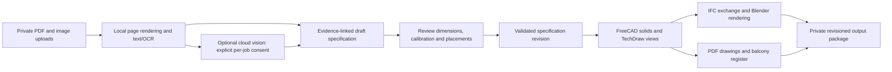

# Architecture and acceptance plan

## Data flow

FastAPI serves a dependency-free browser interface on loopback. A single local worker serializes ingestion and CAD workloads. PDF decoding runs in a child process; optional Poppler rendering uses a bounded subprocess per page. Project state is stored atomically as JSON. Startup marks interrupted jobs for retry. There is no hidden external queue, data sync or background upload.

## Source evidence and identity

Each source has an internal random ID, content hash and private original filename. Each prepared page records its source, page number, dimensions, extracted text, optional calibration and classification. Measurements have a value in mm, method, confidence, page reference and human review flag.

Cloud output is schema-validated and cannot mark itself reviewed. Unsupported page references lose their confidence. Conflicting local dimension labels remain unresolved. Source instructions are treated as data and are never evaluated as code.

Balconies have stable IDs, a level, facade position, width, depth, guard height, type, apartment and review status. Re-running proposals does not duplicate existing source-opening assignments. IFC IDs are derived from the project and object identity. Every build freezes its specification revision and exports checksums.

## Current modelling envelope

The rectangular worker creates a hollow wall shell, front openings, floor slabs, a simple roof and trim. The polygon worker accepts a simple outer ring plus disjoint courtyard holes, clips wall strips and slabs to the building area, and uses a flat roof placeholder. Both paths support two generic balcony guard variants. Polygon objects use facade frames derived from persistent corner IDs; balconies can face the street or a courtyard. Boundary and scale are stored separately so an unscaled sketch is never presented as metric geometry. Balcony lengths and positions use native FreeCAD expressions. Plan and section cuts come from the same solids used for the render and IFC.

The specification, not a generated FCStd or Blender file, is the source of truth. Native documents remain useful for inspection and further manual editing, but importing native edits back into the specification is not implemented.

## What must improve for real-project automation

1. **Document understanding:** drawing-region segmentation, rotation/deskew, dimension-chain parsing, Danish OCR benchmarking, revision conflict handling and evidence bounding boxes. Current local parsing is intentionally narrow.
2. **Geometry:** extend the implemented polygon/courtyard and facade-frame support with per-wing heights, pitched roof topology, dormers, party walls and per-storey changes. Keep the initial rectangular path as a tested subset.
3. **Calibration:** separate scale/transform per drawing region, perspective correction from multiple anchors, discrepancy reporting across views and measured site dimensions.
4. **Balcony library:** configurable polygon decks and guard families, detailed editable profiles and access-opening associations. No proprietary family conversion is assumed.
5. **Placement review:** extend the implemented facade overlays and tables with stack propagation, stable apartment mapping, clearance rules and review of proposed window-to-door changes.
6. **Production operation:** transactional storage/job queue, project backups, access control, team audit trail, retention controls, packaged installers and application-level migrations.

## Measure the 90-95% target

Use a private benchmark set of representative projects with independently checked geometry. Do not publish benchmark inputs or derived client models. Include dimensioned vector PDFs, poor scans, mixed-scale sheets, photos and conflicting revisions.

Measure separately:

- Fraction of required envelope, level and opening fields recovered within agreed tolerances.
- Correct balcony locations, sizes and type assignments, including false proposals.
- Manual correction time versus the existing workflow.
- Completeness of required plans, sections, elevations, schedules and sales views.
- Traceability of inferred dimensions and rate of unflagged errors.

Agree tolerances for sales models before evaluating. A useful initial acceptance target is 90-95% reduction in repetitive first-draft work while retaining explicit review for uncertain or consequential geometry. Do not combine that with a claim of construction accuracy. The synthetic demonstration proves pipeline integration only.

## Publication boundary

Only generic application code, tests, documentation and source-generated synthetic fixtures belong in Git. Runtime projects, screenshots containing client content, source hashes tied to clients, addresses, native IDs, raw prompts/responses, models, registers and API credentials belong outside the repository. The public-tree check can also read an external private deny-list for an additional local review.
